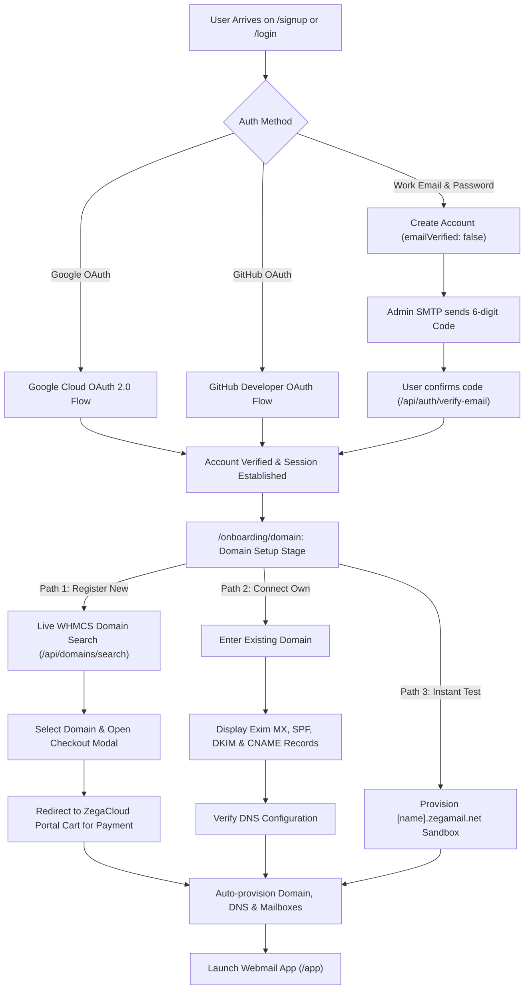

# Zega Mail — Complete Secrets, Environment Variables & Integration Guide

This guide details **every secret, credential, and external integration** required to operate Zega Mail in local development and production (e.g. on Coolify, Docker, or bare-metal VPS).

---

## 1. Where Secrets are Stored

Zega Mail uses standard environment files:

| Environment | Primary File Path | Purpose |
| :--- | :--- | :--- |
| **Local Development (Web)** | `apps/web/.env.local` | Loaded automatically by Next.js during `pnpm dev`. Git-ignored. |
| **Local Monorepo Services** | `.env` | Loaded by root development processes and background workers. |
| **Coolify / Production Deploy** | Coolify Environment UI or `.env.production` | Injected securely as Docker environment variables into containers. |
| **Reference Templates** | `apps/web/.env.example` and `.env.example` | Committed templates documenting every key with instructions. |

---

## 2. Inventory of All Secrets & Integrations

### Group A: Application & Base URLs
```bash
NODE_ENV=development                    # 'development' | 'production'
PORT=3000                               # Web server port
HOSTNAME=0.0.0.0                        # Listen on all interfaces
NEXT_PUBLIC_APP_URL=http://localhost:3000 # Canonical URL (use https://mail.zegacloud.com in prod)
```

---

### Group B: Authentication, Sessions & Master Encryption
```bash
# Random 64-character hex strings for signing session cookies
# Generate with: openssl rand -hex 32
NEXTAUTH_SECRET=your_64_char_hex_secret_here
SESSION_SECRET=your_64_char_hex_secret_here
JWT_SECRET=your_32_char_jwt_secret_here
NEXTAUTH_URL=http://localhost:3000

# 32-byte hex master encryption key for AES-256-GCM mailbox password protection
# Generate with: node -e "console.log(require('crypto').randomBytes(32).toString('hex'))"
ENCRYPTION_MASTER_KEY=e4f9b2d89a710c53820fa49bebc8d01f54316ae82d1c9ef0a45bd7e812cb49ef
```

---

### Group C: Google OAuth 2.0 (Google Sign-In & Sign-Up)
Enables one-click authentication for users with pre-verified email addresses.

#### How to Obtain:
1. Go to [Google Cloud Console](https://console.cloud.google.com/apis/credentials).
2. Create or select a project (e.g., `ZegaMail-Auth`).
3. Navigate to **APIs & Services > Credentials > Create Credentials > OAuth Client ID**.
4. Application Type: **Web application**.
5. Add **Authorized JavaScript Origins**:
   - `http://localhost:3000` (development)
   - `https://mail.zegacloud.com` (production)
6. Add **Authorized Redirect URIs**:
   - `http://localhost:3000/api/auth/callback/google`
   - `https://mail.zegacloud.com/api/auth/callback/google`
7. Copy the credentials into `.env.local`:
```bash
GOOGLE_CLIENT_ID=123456789-abcdef.apps.googleusercontent.com
GOOGLE_CLIENT_SECRET=GOCSPX-your_google_client_secret
GOOGLE_REDIRECT_URI=http://localhost:3000/api/auth/callback/google
```
*Note: In development, if these are omitted, Zega Mail automatically routes through the built-in Developer Sandbox OAuth Simulator with zero friction.*

---

### Group D: GitHub OAuth (GitHub Sign-In & Sign-Up)
Enables developer-friendly sign-in with email extraction.

#### How to Obtain:
1. Go to [GitHub Settings > Developer Settings > OAuth Apps](https://github.com/settings/developers).
2. Click **New OAuth App**.
3. Application name: `Zega Mail`.
4. Homepage URL: `http://localhost:3000` (or `https://mail.zegacloud.com`).
5. Authorization callback URL: `http://localhost:3000/api/auth/callback/github` (or `https://mail.zegacloud.com/api/auth/callback/github`).
6. Copy into `.env.local`:
```bash
GITHUB_CLIENT_ID=Iv1.your_github_client_id
GITHUB_CLIENT_SECRET=your_github_client_secret
GITHUB_REDIRECT_URI=http://localhost:3000/api/auth/callback/github
```

---

### Group E: Admin System SMTP (Account Confirmation Codes & Transactional Mail)
Used by the application to send:
- 6-digit email confirmation codes during signup
- Password reset instructions
- Automated payment invoices and DNS verification notifications

```bash
SMTP_HOST=mail.zegacloud.com           # SMTP hostname (cPanel Exim, AWS SES, SendGrid, etc.)
SMTP_PORT=465                          # 465 (SSL/TLS) or 587 (STARTTLS)
SMTP_SECURE=true                       # true for port 465, false for port 587
SMTP_USER=noreply@zegacloud.com        # Admin SMTP mailbox
SMTP_PASSWORD=your_secure_password_here
SMTP_FROM_EMAIL=noreply@zegacloud.com
SMTP_FROM_NAME="ZegaCloud Security & Verification"
```
*Note: In development, if SMTP credentials are blank, Zega Mail logs the 6-digit confirmation code directly to the server terminal and surfaces a dev badge (`Dev Preview Code: XXXXXX`) so testing is never blocked.*

---

### Group F: WHMCS Billing & Domain Automation API
Controls real-time domain availability search, domain purchases, invoice generation, and 1-Click Client SSO into `billing.zegacloud.com`.

#### How to Obtain:
1. In WHMCS Admin, go to **Setup > Staff Management > API Roles**.
2. Create an API Role with permissions: `GetTLDPricing`, `CheckDomainAvailability`, `CreateOrder`, `GetInvoices`, `UpdateClient`.
3. Go to **Setup > Staff Management > Administrator Users** and assign the API Role.
4. Copy into `.env.local`:
```bash
WHMCS_API_URL=https://billing.zegacloud.com/includes/api.php
WHMCS_BASE_URL=https://billing.zegacloud.com
WHMCS_API_IDENTIFIER=your_whmcs_api_role_identifier
WHMCS_API_SECRET=your_whmcs_api_role_secret
WHMCS_CLIENT_SSO_SECRET=super_secret_whmcs_sso_shared_key
WHMCS_INTERNAL_WEBHOOK_SECRET=super_secret_whmcs_webhook_token
```

---

### Group G: cPanel / WHM API (Exim/Dovecot Mailbox & DNS Automation)
Controls mailbox provisioning, quota assignment, and live DKIM/SPF/MX DNS record querying.

#### How to Obtain:
1. Log into your cPanel account.
2. Search for **Manage API Tokens** in the search bar.
3. Create a token named `ZegaMailAutomation` with permissions for `Email` and `ZoneEditor`.
4. Copy into `.env.local`:
```bash
CPANEL_HOST=mail.zegacloud.com
CPANEL_PORT=2083
CPANEL_USERNAME=cpanel_account_user
CPANEL_API_TOKEN=CPANEL_UAPI_TOKEN_HERE
CPANEL_SECURE=true
```

---

### Group H: Billing & Payment Processing Architecture (Centralized in ZegaCloud / WHMCS)

In accordance with enterprise separation of concerns (identical to Titan Mail and Google Workspace), all payment processing, merchant gateways (Paystack, Flutterwave, Stripe), and crypto invoicing are handled centrally by the **ZegaCloud Billing & Client Portal** (`billing.zegacloud.com`).

**Advantages**:
- **Zero Local Secrets**: The webmail application requires no payment gateway secret keys in its `.env`.
- **PCI-DSS Compliance**: Credit cards and payment credentials never touch the web application.
- **Unified Invoicing**: All subscriptions, renewals, VAT compliance, and multi-gateway settlements are consolidated in WHMCS.

#### WHMCS Payment Gateways Setup:
1. Log in to your WHMCS Admin Portal at `https://billing.zegacloud.com/admin`.
2. Navigate to **System Settings > Payment Gateways**.
3. Activate your desired gateways (Paystack, Flutterwave, Stripe, Crypto).
4. Enter your live merchant credentials directly inside WHMCS.
5. Create your ZegaMail products in WHMCS (`Setup > Products/Services`):
   - Starter Plan (PID: 1)
   - Growth Plan (PID: 2)
   - Enterprise Pro Plan (PID: 3)

---

## 3. Step-by-Step Flow Architecture



---

## 4. Verification & Testing Checklist

- [x] **Email Signup + 6-Digit Code**: Tested via `/api/auth/signup` and `/api/auth/verify-email`.
- [x] **Google & GitHub OAuth**: Handlers configured at `/api/auth/google`, `/api/auth/github` with Developer Sandbox fallback.
- [x] **WHMCS Domain Search**: Tested at `/api/domains/search?domain=...`.
- [x] **Centralized Billing Integration**: Directly routes to ZegaCloud WHMCS Cart with zero local payment secrets.
- [x] **App Performance**: Optimized with Next.js `optimizePackageImports` and unified `/api/bootstrap` endpoint.
